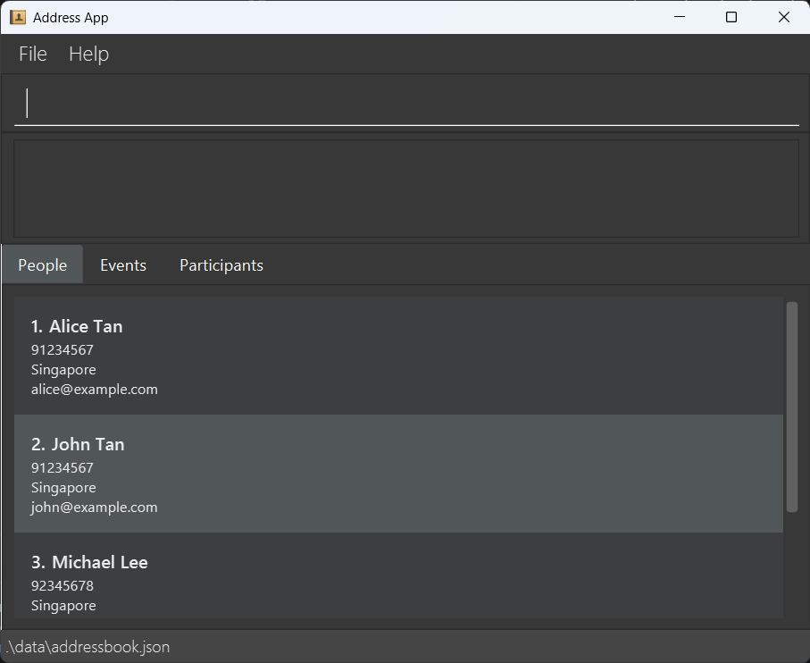
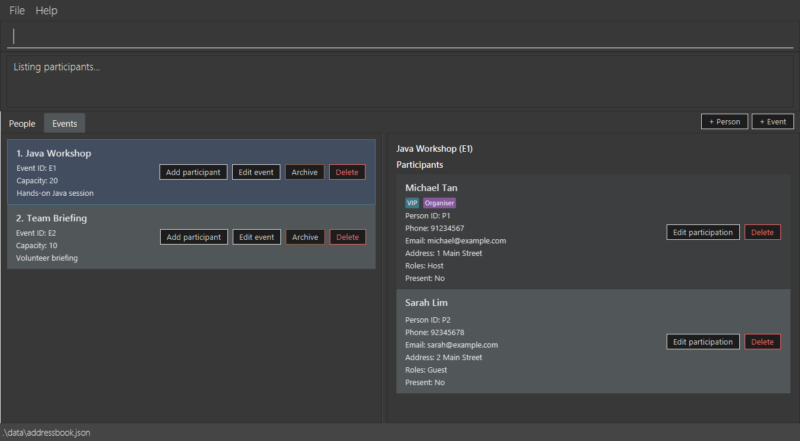
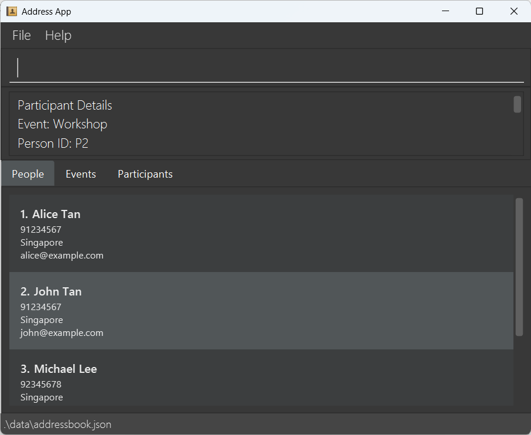
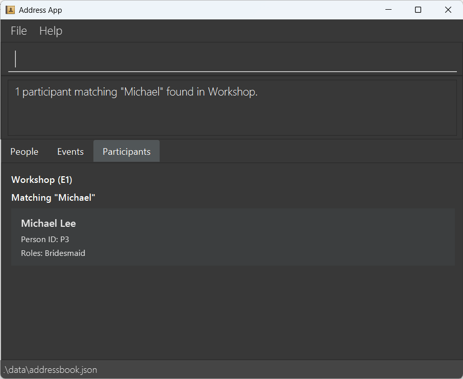
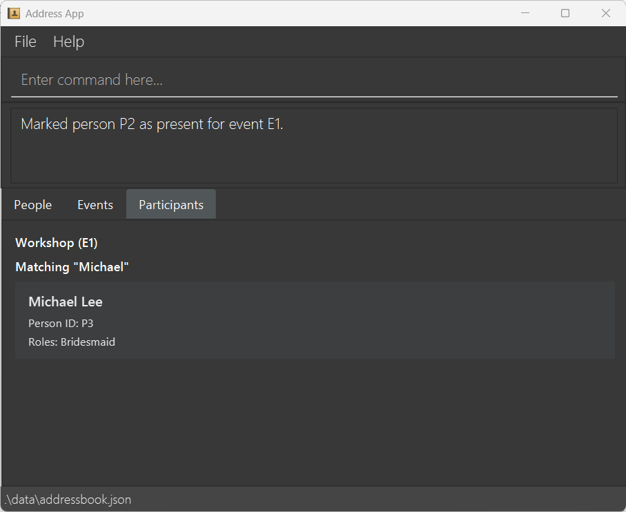
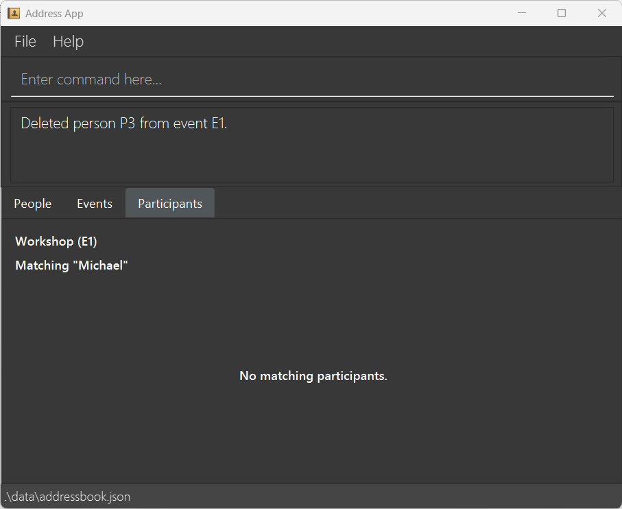
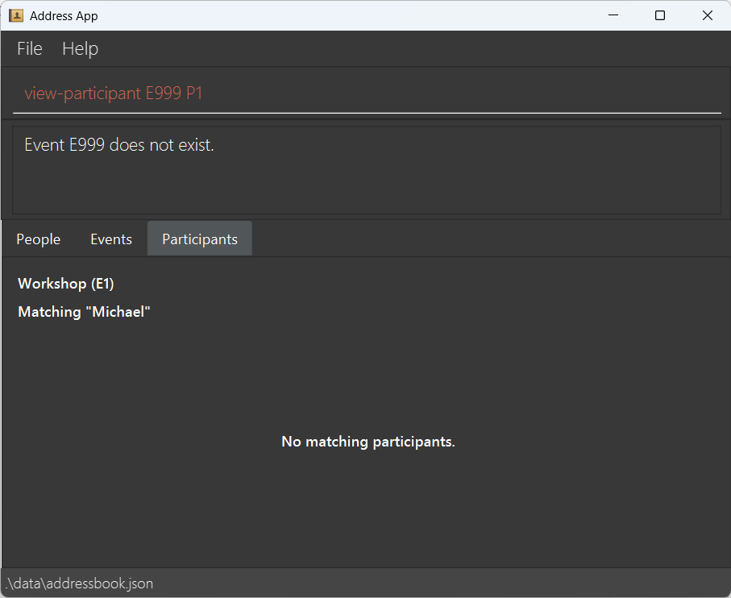

# AttendPlusPlus User Guide

AttendPlusPlus is a **desktop application for managing events and their participants**. It combines a Command Line Interface (CLI) for efficient management with a Graphical User Interface (GUI) for viewing people, events and participants.

<!-- * Table of Contents -->
<page-nav-print />

---

## Quick start

1. Ensure that Java `25` or later is installed on your computer. **Mac users:** Follow the JDK setup instructions [here](https://se-education.org/guides/tutorials/javaInstallationMac.html).
2. Download the latest AttendPlusPlus `.jar` file from the [project releases page](https://github.com/AY2627S1-CS2103-F12-4/tp/releases), if a release is available.
3. Place the JAR file in a folder of your choice.
4. Open a terminal in that folder and run `java -jar FILENAME.jar`, replacing `FILENAME.jar` with the downloaded JAR filename.
5. The application window will appear with tabs for people, events and participants.

   

6. Enter a command in the command box and press **Enter**. You can try `help`, `list`, or `list-event`.
7. Refer to [Features](#features) for command details.

---

## Features

Successful commands show a short status message in the output panel, such as
`Event added successfully.` or `Viewing event...`. View lists and details in the GUI panels.
Failed commands continue to show the specific error and usage guidance where applicable.

<box type="info" seamless>

**Command format conventions:**

* `UPPER_CASE` indicates a value you must replace, e.g., `EVENT_ID` could be `E1`.
* Square brackets `[ ]` indicate optional arguments.
* `...` indicates an argument that can be repeated.
* Event IDs (e.g., `E1`) and person IDs (e.g., `P1`) are different from the numbered indices displayed in person lists. Use the identifier required by each command.
* Some person-editing commands accept prefixed arguments in any order. For event/participant commands, follow the order shown in the format.

</box>

### Viewing help: `help`

Shows information on how to access the help page.

Format: `help`

### Adding a person: `add`

Adds a person to the address book. A person must exist before they can be registered for an event. People may have the same name because each person is assigned a unique ID.

Format: `add n/NAME p/PHONE_NUMBER e/EMAIL a/ADDRESS [t/TAG]...`

Examples:
* `add n/John Tan p/91234567 e/john@example.com a/Singapore`
* `add n/Michael Lee p/92345678 e/michael@example.com a/Singapore t/VIP`

### Listing all people: `list`

Shows all people in the address book.

Format: `list`

### Editing a person: `edit`

Updates an existing person's details.

Format: `edit INDEX [n/NAME] [p/PHONE] [e/EMAIL] [a/ADDRESS] [t/TAG]...`

* `INDEX` is the positive integer shown in the currently displayed person list (1, 2, 3, ...).
* Provide at least one field to update.
* Providing tags replaces the person's existing tags; `t/` clears all tags.

Examples:
* `edit 1 p/91234567 e/john@example.com`
* `edit 2 n/Michael Tan t/`

### Finding people by name: `find`

Finds people whose names match any of the supplied keywords (case-insensitive, whole-word matching).

Format: `find KEYWORD [MORE_KEYWORDS]`

Examples:
* `find John`
* `find alex david`

### Deleting a person: `delete`

Deletes the person at the specified displayed list index. This also removes that person's registrations from all events. To remove someone from only one event, use `del-participant` instead.

Format: `delete INDEX`

Example: `delete 2`

### Creating an event: `add-event`

Creates an event with a name, capacity and required `/desc` parameter. The description value may be empty.

Format: `add-event EVENT_NAME /cap CAPACITY /desc DESCRIPTION`

Example: `add-event Wedding /cap 50 /desc Wedding Ceremony`

### Editing an event: `edit-event`

Updates an event identified by its stable Event ID. Supply at least one of a new name,
capacity or description. Omitted fields retain their existing values; an empty
`/desc` clears the description. The optional name appears directly after the ID,
before any prefixed fields. Names may contain spaces and may match another event's name.

The Event ID, registrations, roles, tags and attendance are preserved. Reducing
capacity below the registration count does not remove existing participants.

Format: `edit-event EVENT_ID [EVENT_NAME] [/cap CAPACITY] [/desc DESCRIPTION]`

Examples:
* `edit-event E1 Wedding Reception`
* `edit-event E1 /cap 80`
* `edit-event E1 /desc`
* `edit-event E1 Wedding Reception /cap 80 /desc Updated venue`

### Archiving and restoring events

Format: `archive-event EVENT_ID` or `unarchive-event EVENT_ID`

Use the stable Event ID, such as `E1`. This identifies the event even when multiple
events share a name. Missing or invalid IDs produce an error. Archiving an already
archived event, or restoring an active event, also produces an error.

Archived events are hidden from the event list and `find-event` results, including
after restarting the app. Restore an event by ID to show it again (subject to the
current search filter). Direct viewing by ID remains available and shows
`<archived>` after the event name. Their IDs,
registrations and attendance are preserved. Archive state is saved between sessions.
For this initial version, all other event operations remain available.

Examples:
* `archive-event E1`
* `unarchive-event E1`

### Listing events: `list-event`

Displays the events in the application.

Format: `list-event`

### Viewing event details: `view-event`

Displays details for an event identified by its event ID.

Format: `view-event EVENT_ID`

Example: `view-event E1`

### Adding a participant: `add-participant`

Registers an existing person for an event. Optional roles and event-specific tags may be supplied. A person cannot be registered twice for the same event.

Format: `add-participant EVENT_ID PERSON_ID [/role ROLE]... [/tag TAG]...`

Examples:
* `add-participant E1 P1`
* `add-participant E1 P2 /role Best Man`
* `add-participant E1 P3 /role Bridesmaid /tag VIP`

The person must already exist in the address book. Role information applies to that person's participation in this event, rather than all their events.

### Editing a participant: `edit-participant`

Updates an existing registration's roles and tags without changing the person's
contact details or attendance. Supply at least one `/role` or `/tag` field.
An omitted field is preserved; supplied values replace the entire corresponding set.
Use a single empty `/role` or `/tag` to clear that set. Do not mix an empty
value with other values for the same field. Repeated identical values are deduplicated.

Format: `edit-participant EVENT_ID PERSON_ID [/role ROLE]... [/tag TAG]...`

Examples:
* `edit-participant E1 P1 /role Speaker /role Host /tag VIP`
* `edit-participant E1 P1 /tag Guest`
* `edit-participant E1 P1 /role /tag`

### Listing participants in an event: `list-participants`

Lists the people registered for the specified event, including their IDs, names and roles.

Format: `list-participants EVENT_ID`

Example: `list-participants E1`

### Viewing participant details: `view-participant`

Displays a participant's contact details and event-specific information, including roles and attendance status.

Format: `view-participant EVENT_ID PERSON_ID`

Example: `view-participant E1 P2`

### Searching participants by name: `search-participant`

Finds matching people registered for a specified event; it does not search unrelated events.

Format: `search-participant EVENT_ID /name NAME`

Example: `search-participant E1 /name Michael`

### Searching participants by role: `search-role`

Finds registrations with matching event-specific roles across all nonarchived events,
or within one event when `/event EVENTID` is supplied.

Format: `search-role ROLE [/event EVENTID]`

Examples:

* `search-role Best Man` searches all nonarchived events.
* `search-role Best Man /event E1` searches only event `E1`.
* `search-role man` matches roles such as `Best Man` and `Manager`.

Matching is case-insensitive and uses the complete search phrase as a substring of
an individual role. Leading and trailing whitespace is ignored, and consecutive
whitespace in the query is treated as one space. A registration matches if any of
its roles matches; text from separate roles is not combined. Registrations without
roles do not match. Put the optional `/event EVENTID` after the role phrase;
duplicate `/event` arguments and unsupported command prefixes produce an error.

The command selects the **Events** tab and shows only events containing matching
registrations. Switch to the **Participants** tab to see the matching registrations,
including all their assigned roles. Its heading shows either **All nonarchived
events** or the scoped event's name and ID, together with the search phrase.
Switching tabs preserves the search. Events follow their stored order, and
registrations within each event are ordered lexicographically by Person ID
(for example, `P1`, `P10`, `P2`).

Feedback counts registrations and matching events. A registration counts once even
if several of its roles match. The same person registered in two matching events
counts as two registrations. If nothing matches, both result lists are empty.
Archived events are excluded even when explicitly scoped. An unknown event ID
produces an error and preserves the previous results.

A new role search replaces the previous search and event filter, and searches
independently of the displayed people list. Results refresh when registrations,
participant details, or event details change, including archiving or restoring an
event. Deleting the scoped event clears the search; deleting an event during a
global search refreshes the remaining matches. Use `list-event` to clear the role
search and show all nonarchived events, or `find-event` to replace it with an event
name filter. A participant name search also replaces the role search and restores
the ordinary nonarchived event list.

### Marking attendance: `mark-participant`

Marks a registered participant as present at the specified event.

Format: `mark-participant EVENT_ID PERSON_ID`

Example: `mark-participant E1 P2`

### Cancelling attendance: `unmark-participant`

Marks a registered participant as absent without removing their registration, roles or tags.
The participant must currently be marked as present; otherwise, an error is shown.

Format: `unmark-participant EVENT_ID PERSON_ID`

Example: `unmark-participant E1 P2`

### Removing a participant: `del-participant`

Removes the person's registration from the specified event. The underlying person remains in the address book.

Format: `del-participant EVENT_ID PERSON_ID`

Example: `del-participant E1 P3`

### Handling invalid IDs

Commands referencing a nonexistent event, person or participation display an error instead of making the requested change.

Example: `view-participant E999 P1`

### Clearing all people: `clear`

Clears all people from the address book and removes their registrations across events. **Use with caution.**

Format: `clear`

### Exiting: `exit`

Exits the application.

Format: `exit`

### Saving data

AttendPlusPlus saves its application data automatically. You do not need to save manually.

### Editing data files

Application data is stored in JSON files. Editing these files manually can cause invalid or inconsistent data, so back them up before making changes. Using CLI commands is recommended.

---

## FAQ

**Q:** How do I add a new person to an event?  
**A:** First add them with `add` if needed, then register them using `add-participant EVENT_ID PERSON_ID`. The current People list shows numbered indices, **not permanent person IDs** such as `P1`. You must obtain the correct person ID from an available command or record that explicitly shows it; do not assume the list index equals the ID. If no ID is shown, this is a current UI limitation.

**Q:** Does `del-participant` delete the person's contact details?  
**A:** No. It removes the participation in the specified event, not the underlying person record.

---

## Known issues

* If the app window opens off-screen after disconnecting a secondary display, resetting the saved window preferences may restore its position.
* If the Help window is minimised, open that existing window again instead of expecting a second Help window.

---

## Command summary

| Action | Format and example |
|---|---|
| **Help** | `help` |
| **Add person** | `add n/NAME p/PHONE_NUMBER e/EMAIL a/ADDRESS [t/TAG]...` |
| **List people** | `list` |
| **Edit person** | `edit INDEX [n/NAME] [p/PHONE] [e/EMAIL] [a/ADDRESS] [t/TAG]...` |
| **Find people** | `find KEYWORD [MORE_KEYWORDS]` |
| **Delete person** | `delete INDEX` |
| **Add event** | `add-event EVENT_NAME /cap CAPACITY /desc DESCRIPTION` |
| **Edit event** | `edit-event EVENT_ID [EVENT_NAME] [/cap CAPACITY] [/desc DESCRIPTION]` |
| **Archive event** | `archive-event EVENT_ID` |
| **Restore event** | `unarchive-event EVENT_ID` |
| **List events** | `list-event` |
| **View event** | `view-event EVENT_ID` |
| **Add participant** | `add-participant EVENT_ID PERSON_ID [/role ROLE]... [/tag TAG]...` |
| **Edit participant** | `edit-participant EVENT_ID PERSON_ID [/role ROLE]... [/tag TAG]...` |
| **List participants** | `list-participants EVENT_ID` |
| **View participant** | `view-participant EVENT_ID PERSON_ID` |
| **Search participant** | `search-participant EVENT_ID /name NAME` |
| **Search role** | `search-role ROLE [/event EVENTID]` |
| **Cancel attendance** | `unmark-participant EVENT_ID PERSON_ID` |
| **Mark attendance** | `mark-participant EVENT_ID PERSON_ID` |
| **Remove participant** | `del-participant EVENT_ID PERSON_ID` |
| **Clear people** | `clear` |
| **Exit** | `exit` |
