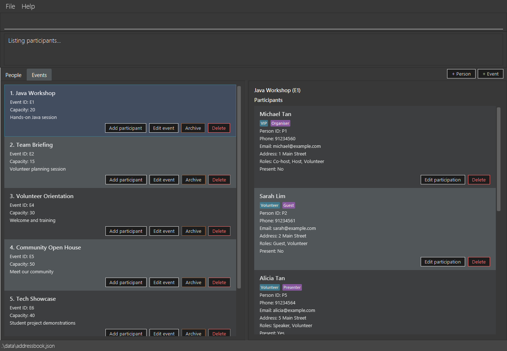

# AttendPlusPlus

**AttendPlusPlus is a desktop application for event organisers to manage events, participants, and attendance in one place.** It combines command-line input with a graphical interface to help organisers access and manage event information efficiently.

* If you are interested in using AttendPlusPlus, head over to the [_Quick Start_ section of the **User Guide**](UserGuide.html#quick-start).
* If you are interested in developing AttendPlusPlus, the [**Developer Guide**](DeveloperGuide.html) is a good place to start.

**Acknowledgements**

* AttendPlusPlus is based on [AddressBook Level 3](https://github.com/se-edu/addressbook-level3) by the [SE-EDU initiative](https://se-education.org).
* Libraries used: [JavaFX](https://openjfx.io/), [Jackson](https://github.com/FasterXML/jackson), [JUnit5](https://github.com/junit-team/junit5)
